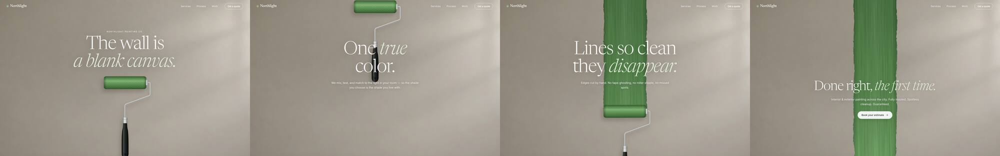

# Northlight Painting Co. — website

A one-page marketing website for a residential & commercial painting company.
The signature feature is a **scroll-driven paint roller**: as you scroll, a roller rises
up the "wall", then rolls down and paints a green stripe while the headline changes.

> All business details are **placeholders**. See [`CLIENT_INFO.md`](CLIENT_INFO.md) for the
> full list and a ready-made prompt for swapping in the client's real information.

Author: **Rajdeep Sah**



---

## Quick start

No build step and no dependencies. Any static web server works.

```bash
npm start            # serves the site at http://localhost:8080
# or: node scripts/serve.mjs 3000
# or: python3 -m http.server 8080
```

Then open <http://localhost:8080>.

## Tests

```bash
npm test
```

Runs `tests/smoke.mjs` with Playwright — 30 checks on desktop, mobile, reduced motion and
with JavaScript turned off: console errors,
broken images, horizontal overflow, the hero animation states, header behaviour,
mobile menu, gallery lightbox and the quote form. Screenshots are written to
`tests/output/` (ignored by git).

If Playwright is not installed on your machine: `npm i -D playwright && npx playwright install chromium`.

## Project structure

```
index.html              ← all page content (sections are marked with comments)
assets/
  css/styles.css        ← all styles; colours/fonts are CSS variables at the top
  js/main.js            ← hero roller animation, reveals, carousel, lightbox, form
  img/                  ← optimised images (.webp + .jpg fallbacks), favicon
  fonts/                ← self-hosted Newsreader + Inter (with licence files)
scripts/serve.mjs       ← tiny local server (no dependencies)
tests/smoke.mjs         ← automated browser checks
CLIENT_INFO.md          ← every placeholder value + image prompts (edit before handover)
docs/
  PLAN.md               ← phased development plan
  PROGRESS.md           ← what's done, what's left, how to continue
  VIDEO_REFERENCE.md    ← design notes taken from the reference video
  reference/            ← still frames from the reference video
  screenshots/          ← screenshots of the finished site
robots.txt
```

## Deploying

Upload the whole folder (or connect the repo) to any static host — Netlify, Vercel,
Cloudflare Pages, GitHub Pages or regular shared hosting. There is nothing to build.

## Quote form

By default the form validates input and shows a success message without sending anything.
To receive submissions by email, create a form endpoint (Formspree, Basin, Getform…) and
add it to the form in `index.html`:

```html
<form class="quote-form" data-endpoint="https://formspree.io/f/your-id" …>
```

## Status

Complete and tested — see [`docs/PROGRESS.md`](docs/PROGRESS.md) for what was built, QA results
and the short list of client-specific items to do before launch.

## Browser support

Latest Chrome, Edge, Safari and Firefox on desktop and mobile. Visitors who turn on
"reduce motion" get a static version of the hero.
